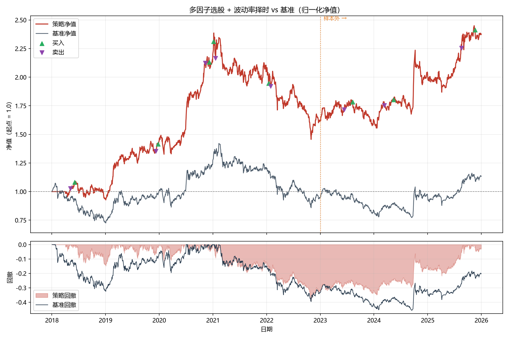
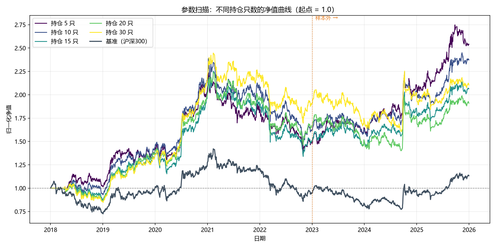
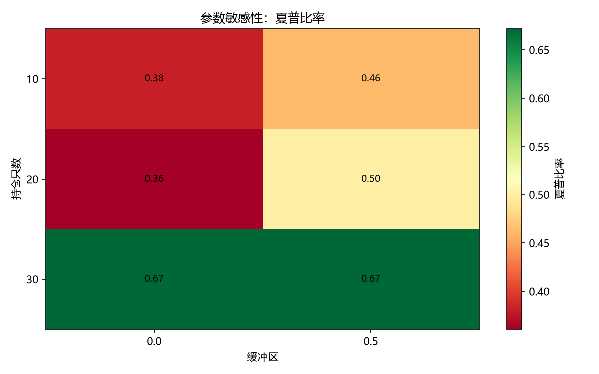

# 多因子选股与波动率目标择时系统

课程：量化交易（周三上午）　组号：（待填）　提交日期：2025-12

本系统包含数据接入、因子计算、信号生成、回测引擎与绩效分析五个模块，策略核心与回测逻辑均为自行实现，未调用第三方回测框架。默认使用 baostock 提供的 A 股后复权日频数据，回测区间 2018-01-01 至 2025-12-31，基准为沪深 300 指数（000300）。

主要结果（30 只 A 股，持仓 10 只，详见第 7 节）：

| 区间 | 策略年化 | 基准年化 | 年化超额 | 策略夏普 | 基准夏普 | 策略最大回撤 | 基准最大回撤 |
|---|---|---|---|---|---|---|---|
| 样本内 2018–2022 | 10.56% | −1.12% | +11.81% | 0.462 | −0.151 | −38.99% | −39.59% |
| 样本外 2023–2025 | 14.21% | 6.25% | +7.49% | 0.755 | 0.249 | −16.42% | −24.80% |
| 全样本 2018–2025 | 11.87% | 1.63% | +10.08% | 0.558 | −0.019 | −38.99% | −45.60% |

上述超额收益主要来自等权持有相对市值加权的风格暴露，而非因子选股能力，具体归因见第 11 节。

---

## 1. 运行环境

Python 3.11（3.10 及以上亦可）。依赖见 `requirements.txt`，测试与静态检查依赖见 `requirements-dev.txt`，可选组件见 `requirements-web.txt` 与 `requirements-frameworks.txt`。

### 1.1 安装

```powershell
py -3.11 -m venv .venv
.\.venv\Scripts\Activate.ps1
pip install -r requirements.txt -i https://pypi.tuna.tsinghua.edu.cn/simple
```

PowerShell 若提示禁止运行脚本，执行一次：

```powershell
Set-ExecutionPolicy -Scope CurrentUser -ExecutionPolicy RemoteSigned
```

### 1.2 运行

```powershell
python main.py
```

首次运行会按 `config.py` 中的数据源下载行情并缓存至 `data/cache/`，此后直接读取本地 parquet 文件。运行结束后，`outputs/` 生成以下文件：

| 文件 | 内容 |
|---|---|
| `metrics.csv` | 样本内、样本外、全样本指标表，附数据源、换手率、交易成本、成交笔数 |
| `nav.png` | 策略与基准的归一化净值曲线，含买卖点标注与回撤子图 |
| `ic.png` | 各因子 RankIC 逐日走势与累计 IC |
| `layered.png` | 因子分层累计净值 |
| `sensitivity.png` | 参数敏感性热力图 |
| `trades.csv` | 逐笔成交记录（日期、代码、方向、股数、价格、金额、费用） |

图表同时复制至 `docs/figures/`，该目录纳入版本控制，便于在报告中引用。

### 1.3 命令行参数

| 参数 | 说明 |
|---|---|
| `--mode {offline,akshare,baostock}` | 指定数据源，覆盖 `config.py` 中的设置 |
| `--no-timing` | 关闭波动率目标择时，用于消融对比 |
| `--quick` | 跳过参数敏感性扫描，缩短运行时间 |

---

## 2. 目录结构

```
quant/
├── main.py                  程序入口，串联完整流程
├── config.py                全部可调参数
├── requirements*.txt        依赖清单
├── data/                    数据层
│   ├── loader.py              数据源调度、akshare 接口、缓存
│   ├── baostock_loader.py     baostock 接口，输出停牌与 ST 标记
│   ├── synthetic.py           离线模拟数据生成
│   └── universe.py            股票池过滤与可交易掩码
├── factors/                 因子层
│   ├── registry.py            因子注册表
│   ├── builtin.py             内置因子
│   ├── preprocess.py          去极值、标准化、中性化
│   └── composite.py           多因子合成
├── strategy/                策略层
│   ├── base.py                策略基类，约定信号时序
│   ├── multi_factor.py        多因子 TopN 选股
│   └── timing.py              波动率目标择时
├── backtest/                回测层
│   ├── engine.py              撮合内核
│   ├── cost.py                费用模型
│   └── metrics.py             绩效指标
├── analysis/                分析层
│   ├── ic.py                  RankIC、分层回测
│   └── plots.py               图表输出
├── adapters/                第三方引擎适配器
│   └── backtrader_engine.py   以 backtrader 复算同一信号，用于交叉验证
├── web/                     Web 界面
│   ├── app.py                 FastAPI 服务
│   └── static/index.html      单页前端
├── tools/                   辅助脚本
│   ├── check_data.py          数据源连通性检查
│   ├── compare_engines.py     双引擎净值对比
│   └── sweep_params.py        参数扫描
├── tests/                   测试
├── docs/                    技术报告与图表
└── outputs/                 运行产物，不纳入版本控制
```

---

## 3. 系统设计

### 3.1 数据流

```
config.py 参数
      │
      ▼
data/     行情面板（date × code）＋ 可交易掩码 ＋ 停牌/ST 标记
      │
      ▼
factors/  因子计算 → MAD 去极值 → 横截面标准化 → 加权合成
      │
      ▼
strategy/ TopN 选股 → 等权 → 缓冲区换手控制 → 波动率目标缩放
      │
      ▼
backtest/ t+1 开盘撮合，逐笔扣除费用，屏蔽停牌与涨跌停
      │
      ▼
analysis/ 绩效指标、净值曲线、因子检验
```

### 3.2 模块职责

| 模块 | 输入 | 输出 | 关键设计 |
|---|---|---|---|
| 数据层 | 配置 | 面板矩阵、掩码 | 统一为 date × code 的 DataFrame，上游数据源差异被隔离 |
| 因子层 | 面板 | 打分矩阵 | 因子以注册表管理，新增因子不影响其它模块 |
| 策略层 | 打分、掩码 | 目标权重矩阵 | 输出统一为权重，便于替换与对比 |
| 回测层 | 权重、面板、掩码 | 净值、成交记录 | 按份额记账，现金约束与不可交易状态真实生效 |
| 分析层 | 净值、因子 | 指标、图表 | 与回测解耦，可单独调用 |

各模块之间仅通过 DataFrame 传递数据，不传递自定义对象，因此任一模块可单独替换或单独测试。

---

## 4. 策略定义

### 4.1 因子

因子原始值经 MAD 去极值（中位数 ± 3 × 1.4826 × MAD 截断）与横截面 z-score 标准化后按权重合成。全部因子均已调整为数值越大越优。

| 因子 | 定义 | 权重 | 说明 |
|---|---|---|---|
| `mom20` | `close.pct_change(20)` | 0.35 | 20 日动量 |
| `mom60` | `close.pct_change(60)` | 0.20 | 60 日动量 |
| `rev5` | `-close.pct_change(5)` | 0.15 | 5 日反转 |
| `vol20` | `-std(ret, 20)` | 0.30 | 20 日低波动 |

新增因子时，在 `factors/builtin.py` 中定义函数并添加 `@register` 装饰器，再于 `config.py` 中赋予权重，其余模块无需改动。

### 4.2 组合构建

1. 剔除当日不可交易的股票（停牌、一字涨跌停、上市不足 60 个交易日）；
2. 按合成打分排序，选取前 10 只等权持有；
3. 缓冲区：已持仓股票只要仍位于前 15 名内即继续持有，掉出后替换，以降低换手；
4. 每 10 个交易日调仓一次；
5. 单只股票调仓金额低于总市值 0.2% 时不予执行，避免碎单。

### 4.3 风险控制

以过去 20 个交易日的组合已实现波动为估计，将仓位缩放至目标年化波动 18%，仓位上限 100%（不使用杠杆）。波动估计使用前一交易日数据，避免使用当期信息。

---

## 5. 回测假设

| 项目 | 设定 |
|---|---|
| 信号时点 | t 日收盘后生成，t+1 日开盘成交；权重整体 `shift(1)` |
| 成交价格 | 次日开盘价，另计滑点 |
| 佣金 | 万分之 2.5，双边，单笔最低 5 元 |
| 印花税 | 万分之 5，仅卖出方向 |
| 过户费 | 万分之 0.1，双边 |
| 滑点 | 千分之 1 |
| 停牌 | 不可成交，维持原仓位；停牌期间以最近已知价格估值 |
| 一字涨跌停 | 开盘价触及涨跌停即视为不可成交 |
| 涨跌停幅度 | 主板 10%，主板 ST 5%，创业板与科创板 20%，北交所 30% |
| 持仓 | 等权，整数股，现金不足时按可用资金缩减 |
| 复权 | 后复权，收益率不含除权跳空 |
| 基准 | 沪深 300 指数，价格指数，不含分红 |

停牌期间若以缺失值（NaN）直接估值，会使持仓市值归零并产生虚假回撤。引擎维护逐股最近已知价格用于估值，该行为由 `tests/test_suspension.py` 覆盖。

---

## 6. 数据源

系统支持三种数据源，通过 `config.py` 中 `data.mode` 或命令行参数切换。

| 模式 | 说明 |
|---|---|
| `offline` | 内置模拟数据，不联网，用于验证流程完整性 |
| `baostock` | 本项目默认。不限流，原生提供 `tradestatus`（停牌）与 `isST`（ST）字段 |
| `akshare` | 东方财富接口，速度快，但按 IP 限流 |

baostock 的原生字段使停牌识别与 ST 剔除均为逐日判断，无需维护静态名单。

两处需要说明的差异：

- 复权基准不同。同一标的在 akshare 与 baostock 的后复权价格不可直接比较，两套数据分别缓存于 `data/cache/` 与 `data/cache/bs/`，不混用。
- 成交量单位不同。akshare 以手（100 股）计，baostock 以股计。对量价类因子仅相差常数倍数，不改变横截面排序。

数据源连通性可通过 `python tools/check_data.py` 检查。

---

## 7. 回测结果

回测配置：30 只 A 股，持仓 10 只，缓冲区 0.5，调仓周期 10 日，启用波动率目标择时（目标 18%），初始资金 100 万元。样本内 2018-01-01 至 2022-12-31，样本外 2023-01-01 至 2025-12-31，样本外区间仅用于验证，未参与参数选择。

### 7.1 样本内

| 指标 | 策略 | 基准 | 超额 |
|---|---|---|---|
| 累计收益率 | 62.21% | −5.28% | 71.25% |
| 年化收益率 | 10.56% | −1.12% | 11.81% |
| 年化波动率 | 18.54% | 20.68% | — |
| 最大回撤 | −38.99% | −39.59% | — |
| 夏普比率 | 0.462 | −0.151 | — |
| 卡玛比率 | 0.271 | −0.028 | — |
| 信息比率 | — | — | 0.992 |

### 7.2 样本外

| 指标 | 策略 | 基准 | 超额 |
|---|---|---|---|
| 累计收益率 | 46.62% | 19.09% | 23.12% |
| 年化收益率 | 14.21% | 6.25% | 7.49% |
| 年化波动率 | 16.17% | 17.06% | — |
| 最大回撤 | −16.42% | −24.80% | — |
| 夏普比率 | 0.755 | 0.249 | — |
| 卡玛比率 | 0.865 | 0.252 | — |
| 信息比率 | — | — | 0.778 |

### 7.3 净值曲线



### 7.4 交易特征

年均单边换手率 5.7 倍，全样本成交 1941 笔，累计交易成本 226,016 元，约占初始资金的 22.6%，按初始资金折算年化成本约 2.8%。交易成本是超额收益的主要负向来源。

### 7.5 消融对比

在其余参数与成本均不变的条件下，仅改变是否启用波动率目标择时：

| 组合 | 样本内年化 | 样本内夏普 | 样本内最大回撤 | 样本外年化 | 样本外夏普 |
|---|---|---|---|---|---|
| 仅多因子 | 12.09% | 0.445 | −44.85% | 15.33% | 0.769 |
| 多因子 + 择时 | 10.56% | 0.462 | −38.99% | 14.21% | 0.755 |

择时的主要作用为降低回撤：样本内最大回撤由 −44.85% 收窄至 −38.99%，夏普由 0.445 升至 0.462，代价是年化收益下降 1.53 个百分点。样本外两者差异不显著（夏普 0.769 与 0.755），说明该效应在样本外未稳定复现。

---

## 8. 参数选择

持仓只数通过 `python tools/sweep_params.py` 扫描，结果如下（均为真实数据）：

| 持仓只数 | 样本内年化 | 样本内夏普 | 样本外年化 | 样本外夏普 | 年均换手 |
|---|---|---|---|---|---|
| 5 | 8.66% | 0.340 | 20.61% | 1.082 | 8.8 |
| **10** | **10.56%** | **0.462** | **14.21%** | **0.755** | **5.7** |
| 15 | 8.92% | 0.376 | 11.53% | 0.608 | 3.1 |
| 20 | 11.22% | 0.501 | 4.72% | 0.154 | 1.2 |
| 30 | 14.36% | 0.672 | 3.45% | 0.084 | 1.0 |

持仓 10 只的选取依据为先验标准，而非样本外表现：

- 换手率需落在可实现区间。持仓 20 只与 30 只时年均换手分别为 1.2 倍与 1.0 倍，低于多因子策略常见的 5 至 15 倍，说明组合几乎未发生调仓，选股机制失效；
- 集中度需可控。持仓 5 只时单票权重达 20%，个股风险过高。

需要指出，样本外表现对持仓只数高度敏感（5 只为 20.61%，30 只为 3.45%），说明结论稳健性有限，不应据此推断策略具有持续获取超额收益的能力。



---

## 9. 稳健性检验

### 9.1 双引擎交叉验证

以 backtrader 复算同一套目标权重，与自研引擎对比（20 只股票，7 秒）：

| 指标 | 结果 |
|---|---|
| 日收益相关系数 | 0.9958 |
| 年化跟踪误差 | 1.47% |
| 期末净值差异 | +2.12% |

差异来源为估值口径：自研引擎以当日开盘价估值后调仓，backtrader 以上一收盘价估值。两套独立实现的结果高度一致，可作为自研引擎撮合逻辑正确性的间接证据。

```powershell
pip install -r requirements-frameworks.txt -i https://pypi.tuna.tsinghua.edu.cn/simple
python tools/compare_engines.py 20
```

### 9.2 参数敏感性



在持仓 10 至 30 只、缓冲区 0 至 0.5 的范围内，样本内夏普位于 0.36 至 0.67 之间，未出现孤立的参数尖峰。

### 9.3 因子有效性

样本内 RankIC 统计：

| 因子 | RankIC 均值 | ICIR | IC > 0 占比 |
|---|---|---|---|
| `mom20` | −0.0095 | −0.035 | 49.3% |
| `mom60` | −0.0127 | −0.050 | 46.9% |
| `rev5` | +0.0035 | +0.013 | 51.2% |
| `vol20` | −0.0814 | −0.271 | 37.1% |

除 `vol20` 外，其余因子的预测能力接近于零；`vol20` 显著但方向与因子定义相反，说明 2018 至 2022 年样本内高波动个股表现优于低波动个股。该结果与第 11 节的归因结论一致。

---

## 10. 测试

```powershell
python tests\test_engine.py        # 回测引擎行为测试，11 项
python tests\test_suspension.py    # 停牌估值专项测试
python tests\test_baostock.py      # 数据接入解析测试，4 项
```

覆盖的假设包括：信号不存在前视偏差、交易费用计算正确、一字涨停不可成交、ST 股涨跌停幅度为 5%、绩效指标与手算一致、策略与基准相同时超额为零、持仓数超过股票数时权重归一、全市场不可交易时净值不变、单日数据不导致崩溃、因子预热期全为缺失值时空仓、现金不足时不成交、停牌不影响净值估值。

静态检查：

```powershell
pip install -r requirements-dev.txt -i https://pypi.tuna.tsinghua.edu.cn/simple
ruff check . --exclude .venv,tmp
mypy main.py analysis/plots.py web/app.py --ignore-missing-imports
```

---

## 11. 已知局限

1. **超额收益来源。** 对沪深 300 的超额收益主要来自等权构建相对市值加权的风格暴露。同一股票池等权买入持有的样本内年化为 16.77%，高于策略的 10.56%，样本外两者接近（4.81% 与 4.72%）。结合第 9.3 节因子 IC 接近于零的结果，可以认为当前因子组合未提供有效 alpha，策略收益主要由组合构建方式与择时的仓位缩放决定。

2. **幸存者偏差。** 股票池为 30 只当前存续的股票，回测区间起点早于部分标的上市时间，无法反映退市与更替，会高估历史收益。

3. **样本容量。** 30 只股票中选取 10 只，可选范围有限，多因子选股的横截面区分度不足。

4. **未做行业与市值中性化。** 因子暴露可能集中在特定行业或市值区间，超额收益中含未被剥离的风格成分。

5. **交易成本占比高。** 年化成本约 2.7%，在换手率进一步上升时会显著侵蚀收益。

6. **未建模冲击成本。** 当前按固定滑点千分之一计，未考虑大额委托对价格的实际影响。

---

## 12. AI 使用说明

本项目在开发过程中使用 AI 编程助手辅助完成工程骨架搭建、模块划分与部分工具函数编写。代码未引用、克隆或改编任何 GitHub 开源仓库；所采用的方法（多因子加权、MAD 去极值、横截面标准化、RankIC 检验、TopN 等权、缓冲区换手控制、波动率目标择时）均为量化领域的公开通用方法。

因子选择与经济逻辑、回测假设的设定、参数与样本内外划分、结果归因与局限分析由小组成员完成。全部回测数值均通过 `python main.py` 在本地实际运行产生，可复现。

---

## 13. 免责声明

本项目仅用于课程学习与研究。所有结果基于历史数据，不构成任何投资建议。
