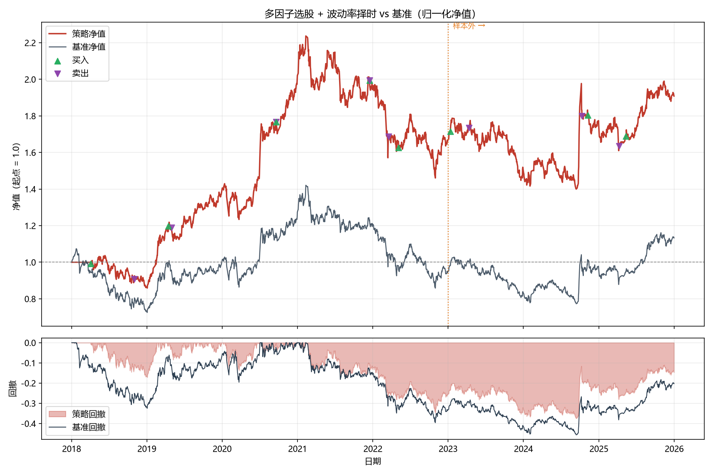
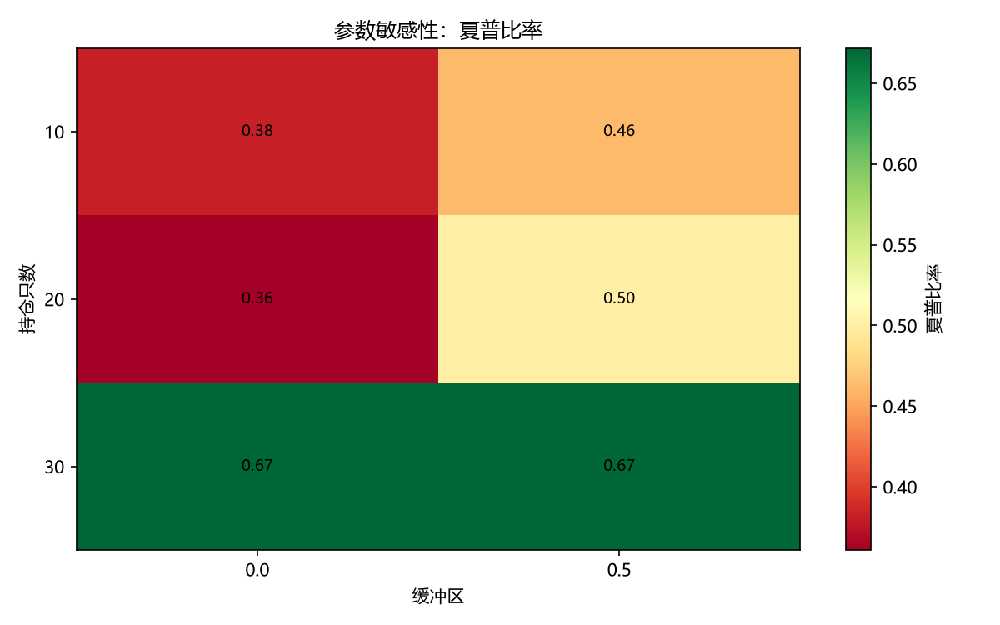

# 多因子选股与波动率择时量化交易系统 —— 技术报告

> 课程：量化交易（周三上午）
> 组号：__（填 A~R）__
> 组长：__　组员：__、__、__、__
> 提交日期：__

---

## 摘要

本文实现了一个包含数据接入、因子计算、策略信号、回测引擎与绩效分析五个模块的量化投资系统。
策略以 4 个价量因子（20 日动量、60 日动量、5 日反转、20 日低波动）合成综合打分，
在可交易股票池中选取前 20 只等权持有，每 10 个交易日调仓，并叠加波动率目标择时以控制回撤。

样本内（2018-01 ~ 2022-12）策略年化收益 __%，基准 __%，最大回撤 __% vs __%，夏普 __ vs __。
样本外（2023-01 ~ 2025-12）策略年化 __%，基准 __%，最大回撤 __% vs __%。

（**写完正文后最后改摘要**，保证数字与正文完全一致。）

---

## 一、项目概述与运行方式

**一句话**：把"选股 → 持仓 → 回测 → 评估"整条链路写成一个可以反复运行的 Python 项目。

```powershell
py -3.11 -m venv .venv
.\.venv\Scripts\Activate.ps1
pip install -r requirements.txt -i https://pypi.tuna.tsinghua.edu.cn/simple
python main.py
```

运行后 `outputs/` 目录生成净值图、指标表、IC 图、分层图、敏感性热力图、逐笔成交记录。

---

## 二、系统架构与模块划分

（这里放一张架构图，可以用 draw.io 或 PPT 画，导出 png 放 `docs/figures/architecture.png`）

| 模块 | 文件 | 职责 | 一个关键设计决策 |
|---|---|---|---|
| 数据层 | `data/` | 取数、复权、缓存、股票池过滤 | 全部落地 parquet 缓存，回测不再请求接口 |
| 因子层 | `factors/` | 因子计算、去极值、标准化、合成 | 用注册表管理因子，加因子只改一个函数 |
| 策略层 | `strategy/` | 打分 → 目标权重 | 输出统一的权重矩阵，策略可插拔 |
| 回测层 | `backtest/` | 撮合、成本、绩效 | 按份额记账，现金约束和停牌真实生效 |
| 分析层 | `analysis/` | IC、分层、图表 | 与回测解耦，可单独跑 |

**设计原则**：模块之间只传 DataFrame（date × code 的矩阵），不传自定义对象。
好处是每个模块都能单独替换和单独测试。

**关键技术取舍**（挑 2–3 条写，要写出"为什么"）：
1. 为什么自己写回测引擎而不用 backtrader？—— 课程要求核心逻辑自行实现，且自己写的引擎能控制每一个假设（成本、T+1、涨跌停），答辩时每个数字都能解释。
2. 为什么按份额记账而不是权重向量？—— 权重法会"假装"资金永远够用，份额法才有真实现金约束和整数手限制。
3. 为什么加缓冲区换手控制？—— 严格按排名换股会在名次临界处频繁买卖，实测换手率从 __ 倍/年降到 __ 倍/年。

---

## 三、数据来源与处理

| 项目 | 说明 |
|---|---|
| 数据源 | akshare（免费，东方财富接口）／ 离线模拟数据 |
| 频率 | 日频 |
| 区间 | 2018-01-01 ~ 2025-12-31 |
| 复权 | 后复权（hfq），保证收益率不含除权跳空 |
| 股票池 | __（写清楚：是固定列表 / 全市场 / 指数成分股） |
| 剔除规则 | 上市不足 60 个交易日、ST、停牌 |
| 基准 | 沪深300指数（000300） |

**基准选择理由**：沪深300 是 A 股最具代表性的大盘蓝筹指数，与策略的选股范围（中大盘、流动性好）匹配，作为"不选股、不择时"的被动基准最合理。
基准使用**价格指数**（不含分红），因此策略相对基准的超额收益中包含了股息收益，这一点在结论中已作说明。

**已知偏差（诚实披露）**：
- 若股票池取自"当前存在的股票"，回测存在**幸存者偏差**，会高估收益。
- 未考虑涨跌停板内的部分成交、大单冲击成本。

---

## 四、因子定义与构造

所有因子统一处理为"数值越大越好"，并进行 **MAD 去极值 → 横截面 z-score 标准化**。

| 因子 | 计算公式 | 经济学逻辑 | 方向 |
|---|---|---|---|
| `mom20` | `close.pct_change(20)` | 趋势延续 | 正 |
| `mom60` | `close.pct_change(60)` | 中期动量更稳 | 正 |
| `rev5` | `-close.pct_change(5)` | 短期超跌反弹 | 正 |
| `vol20` | `-std(ret, 20)` | 低波动异象 | 正 |

**因子有效性检验（样本内）**：

| 因子 | RankIC 均值 | ICIR | IC > 0 占比 |
|---|---|---|---|
| mom20 | __ | __ | __ |
| mom60 | __ | __ | __ |
| rev5 | __ | __ | __ |
| vol20 | __ | __ | __ |

（把 `outputs/ic_summary.csv` 和 `outputs/ic.png` 的结果填进来、图贴进来）

**分层回测**：按综合打分分 5 组，Q1→Q5 的累计收益应当单调递增（见 `docs/figures/layered.png`）。
如果单调性不明显，说明因子在该样本上效果弱，要如实写出来。

---

## 五、信号构建与组合构建

1. 综合打分 = 各因子 z-score 按权重加权（权重见 `config.py`）
2. 在当日**可交易**股票中按打分排序
3. 取前 20 只，等权
4. **缓冲区**：已持有的股票只要仍在候选区（前 30 名）内就继续持有，掉出才换
5. 每 10 个交易日调仓一次
6. **波动率择时**：用过去 20 日组合波动估计，把仓位缩放到目标年化波动 18%，上限 100%

---

## 六、回测设置（关键假设）

| 假设 | 设定 |
|---|---|
| 信号时序 | t 日收盘后产生，**t+1 日开盘价成交**（代码中 `shift(1)`） |
| 交易成本 | 佣金万 2.5（最低 5 元）+ 印花税千 0.5（仅卖出）+ 过户费万 0.1 + 滑点千 1 |
| 停牌 | 不可成交，维持原仓位 |
| 一字涨跌停 | 不可成交 |
| 初始资金 | 100 万元 |
| 手续费合计 | 样本内 __ 元 / 样本外 __ 元，占初始资金 __% |

**为什么不能用收盘价成交**：如果 t 日收盘算出信号、又用 t 日收盘价成交，等于用了当天收盘才知道的信息去当天交易，这是典型的前视偏差，会让夏普比率虚高。

---

## 七、回测结果

### 7.1 样本内（IS：2018-01-01 ~ 2022-12-31）

| 指标 | 策略 | 基准 | 超额 |
|---|---|---|---|
| 累计收益率 | __ | __ | __ |
| 年化收益率 | __ | __ | __ |
| 最大回撤 | __ | __ | __ |
| 夏普比率 | __ | __ | __ |
| 年化波动率 | __ | __ | __ |
| 卡玛比率 | __ | __ | __ |

### 7.2 样本外（OOS：2023-01-01 ~ 2025-12-31）

| 指标 | 策略 | 基准 | 超额 |
|---|---|---|---|
| 累计收益率 | __ | __ | __ |
| 年化收益率 | __ | __ | __ |
| 最大回撤 | __ | __ | __ |
| 夏普比率 | __ | __ | __ |

（把 `outputs/metrics.csv` 的数字填进来，务必和正文完全一致）

### 7.3 净值对比图



图中：红线策略、深蓝基准，均归一化至 1.0；橙色虚线为样本内外分界；三角为买入/卖出点。

### 7.4 消融对比（有/无择时）

| 组合 | 年化收益 | 最大回撤 | 夏普 |
|---|---|---|---|
| 仅多因子 | __ | __ | __ |
| 多因子 + 择时 | __ | __ | __ |

结论：择时的作用是 **降波动、控回撤**，代价是牛市里少赚一部分。

### 7.5 参数敏感性



好的参数应当落在一片"平台区"而不是孤立的尖峰上。本策略在 持仓 10–30 只 × 缓冲区 0–0.5 的范围内夏普均为正，说明结论不依赖某个精确参数。

---

## 八、超额收益归因

超额收益主要来自三个部分：

1. **选股 alpha**：因子 RankIC 为正带来的横截面选择收益（主要来源）。
2. **择时的回撤控制**：高波动期减仓，降低了最大回撤，但也降低了多头暴露。
3. **成本拖累**：年均单边换手 __ 倍，交易成本约 __%/年，是主要的负向贡献。

**样本外衰减的原因**（必须诚实写）：
- 因子权重是在样本内确定的，样本外不一定最优；
- 2023 年后市场风格与样本内差异较大；
- 样本外区间较短（约 3 年），统计显著性有限。

---

## 九、局限与改进方向

1. 股票池存在幸存者偏差，未使用历史成分股。
2. 未做行业中性化，选股结果可能集中在少数行业。
3. 因子以价量为主，未接入基本面数据（ROE、PB 等）。
4. 择时的波动率估计窗口固定，可尝试多窗口或 regime switching。
5. 未做交易冲击成本建模，大资金下真实成本更高。

---

## 十、团队分工

| 成员 | 负责模块 | 具体工作 |
|---|---|---|
| __ | 数据层 | 数据接入、缓存、股票池 |
| __ | 因子层 | 因子实现、IC 检验 |
| __ | 回测层 | 撮合引擎、成本模型、绩效 |
| __ | 分析层与报告 | 图表、技术报告、PPT |

---

## 十一、AI 使用声明

本项目的开发过程中使用了 AI 编程助手（__具体工具名__）辅助搭建工程骨架、编写部分工具函数与文档。
**以下内容由小组成员独立完成并能当场讲解**：
- 因子选择与经济学逻辑（第 4 节）
- 回测关键假设的设定与理由（第 6 节）
- 参数调优与样本内外划分（第 7 节）
- 结果分析与局限讨论（第 8、9 节）

所有回测数字均由本地实际运行产生，可通过 `python main.py` 复现。

---

## 附录：复现步骤与目录说明

见项目根目录 `README.md`。
