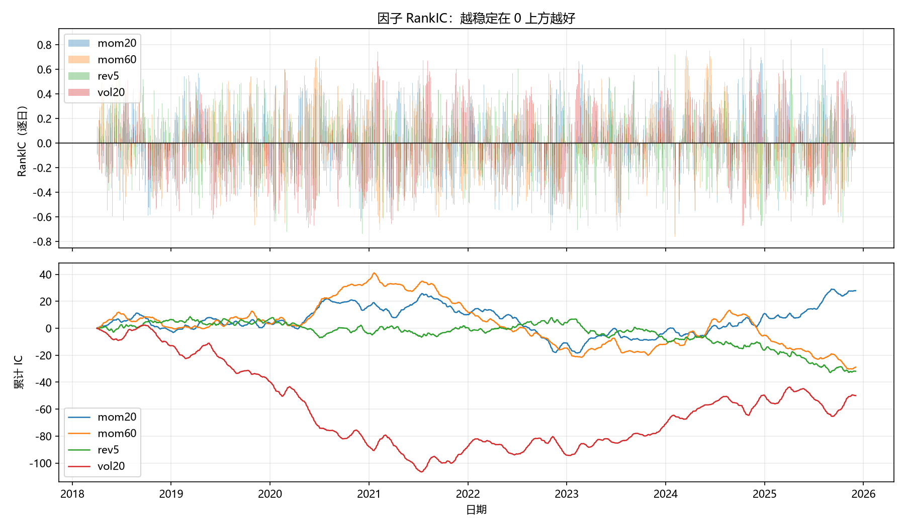
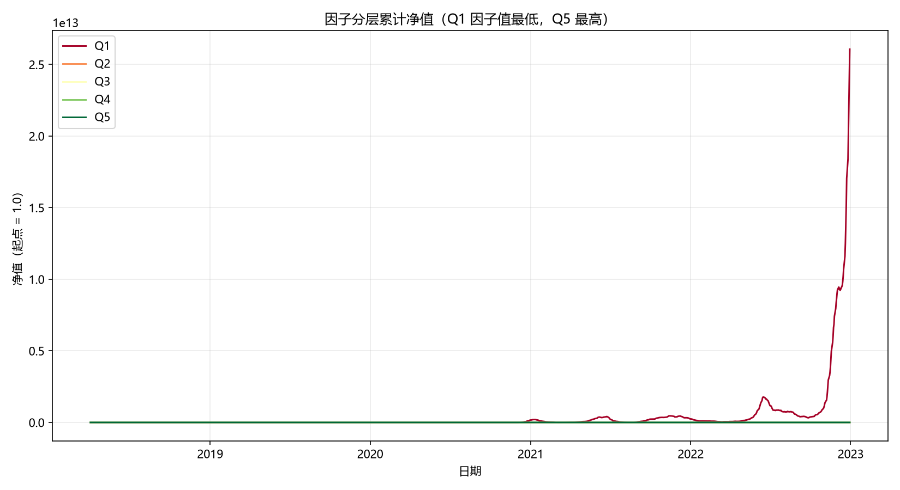
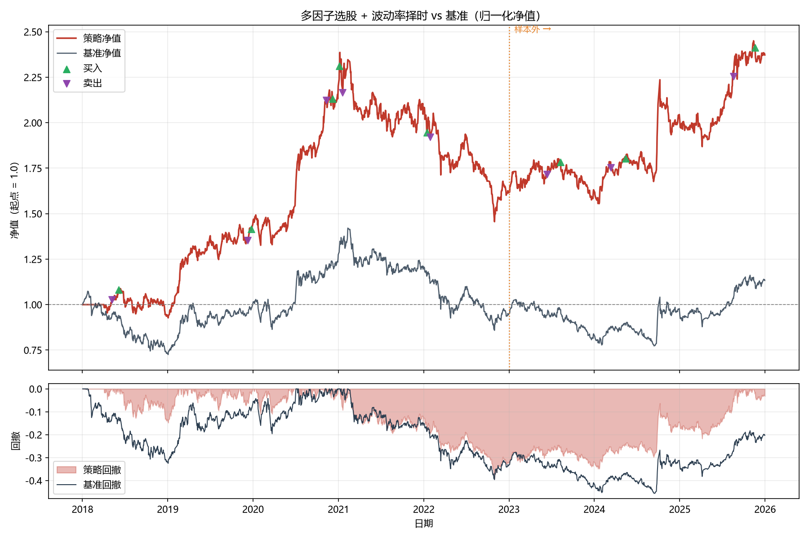
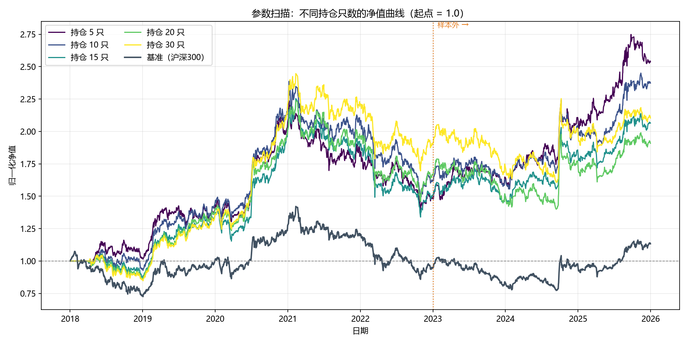
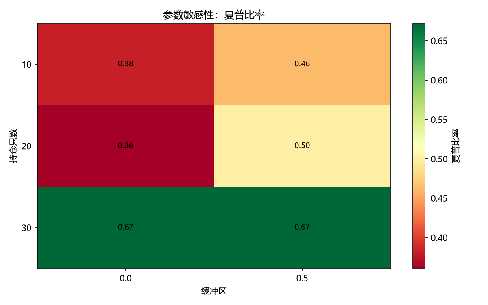

# 多因子选股与波动率目标择时系统 —— 项目技术报告

课程：量化交易（周三上午）　组号：（待填）　组长：（待填）

成员：（待填）

提交日期：2025-12

---

## 摘要

本报告实现了一个包含数据接入、因子计算、信号生成、回测引擎与绩效分析五个模块的 A 股量化投资系统，策略核心与回测逻辑均为自行实现。

策略以 20 日动量、60 日动量、5 日反转、20 日低波动四个价量因子合成打分，在可交易股票池中选取前 10 只等权持有，每 10 个交易日调仓，并叠加波动率目标择时控制回撤。系统使用 baostock 后复权日频数据，回测区间 2018-01-01 至 2025-12-31，基准为沪深 300 指数。

样本内（2018–2022）策略年化收益 10.56%，基准 −1.12%，年化超额 11.81%，夏普比率 0.462 与 −0.151，最大回撤 −38.99% 与 −39.59%。样本外（2023–2025）策略年化 14.21%，基准 6.25%，年化超额 7.49%，夏普 0.755 与 0.249，最大回撤 −16.42% 与 −24.80%。

进一步检验表明，超额收益的来源不能完全归因于因子选股：四个因子的 RankIC 均值介于 −0.081 与 +0.003 之间，多数接近于零；与同股票池等权持有组合相比，策略在样本内落后 6.21 个百分点，在样本外领先 9.40 个百分点，方向不一致。因此无法确认策略具备稳定获取超额收益的能力，详见第 8 节。

---

## 1. 项目概述

### 1.1 目标

构建一个可复现的量化投资系统，覆盖从数据获取到绩效评估的完整链路，并保证回测结论可被检验。

### 1.2 主要工作

1. 实现三种数据源接入（离线模拟、baostock、akshare），统一输出 date × code 的面板矩阵；
2. 实现因子注册机制，支持在不改动其它模块的前提下新增因子；
3. 实现按份额记账的回测引擎，包含 t+1 撮合、A 股费用结构、停牌与涨跌停屏蔽；
4. 实现绩效指标与图表输出，以及 RankIC、分层回测等因子检验工具；
5. 以 backtrader 复算同一信号，与自研引擎交叉验证；
6. 提供 15 项自动化测试，锁定引擎的关键行为。

### 1.3 系统架构

系统分为五个层次，各层之间仅通过 DataFrame 传递数据，不传递自定义对象，因此任一模块可单独替换或单独测试。详细结构与运行方式见仓库 `README.md`。

| 模块 | 职责 | 关键设计 |
|---|---|---|
| 数据层 | 取数、复权、缓存、股票池过滤 | 统一为 date × code 的面板矩阵，隔离数据源差异 |
| 因子层 | 因子计算、去极值、标准化、合成 | 注册表机制，新增因子不影响其它模块 |
| 策略层 | 打分转为目标权重 | 输出统一为权重矩阵，便于替换策略 |
| 回测层 | 撮合、费用、绩效 | 按份额记账，现金约束与不可交易状态真实生效 |
| 分析层 | 指标、图表、因子检验 | 与回测解耦，可单独调用 |

---

## 2. 数据来源与处理

### 2.1 数据源

| 项目 | 说明 |
|---|---|
| 数据源 | baostock（日频） |
| 区间 | 2018-01-01 至 2025-12-31，共 1942 个交易日 |
| 股票池 | 30 只流动性较好的 A 股，覆盖沪深主板、创业板 |
| 复权方式 | 后复权（adjustflag=1） |
| 基准 | 沪深 300 指数（sh.000300），价格指数，不含分红 |

选择 baostock 的原因有二：其一，该数据源不限流，可稳定批量下载；其二，其返回字段原生包含 `tradestatus`（交易状态）与 `isST`（ST 标记），使停牌识别与 ST 剔除均为逐日判断，无需维护静态名单。

### 2.2 预处理

1. **复权**：统一使用后复权价，收益率不含除权跳空。
2. **可交易掩码**：同时满足以下条件的交易日方视为可交易——存在有效价格、成交量大于 0、`tradestatus` 为正常交易、开盘价未触及涨跌停、上市满 60 个交易日、非 ST 状态。
3. **涨跌停幅度**：按板块与 ST 状态区分，主板 10%，主板 ST 5%，创业板与科创板 20%，北交所 30%。
4. **缓存**：下载结果以 parquet 格式缓存；缓存齐全时不发起网络请求。

### 2.3 已知偏差

- 股票池为当前存续的 30 只股票，回测区间起点早于部分标的上市时间，无法反映退市与更替，存在**幸存者偏差**，会高估历史收益。
- 未建模大额委托的冲击成本，仅按固定滑点计。
- 基准为价格指数，不含分红，因此策略相对基准的超额收益中包含了股息收益成分。

---

## 3. 策略设计与因子构造

### 3.1 因子定义

因子原始值经 MAD 去极值（中位数 ± 3 × 1.4826 × MAD 截断）与横截面 z-score 标准化后按权重合成。全部因子均已调整为数值越大越优。

| 因子 | 定义 | 权重 | 经济逻辑 |
|---|---|---|---|
| `mom20` | `close.pct_change(20)` | 0.35 | 短期趋势延续 |
| `mom60` | `close.pct_change(60)` | 0.20 | 中期趋势，较 20 日更稳定 |
| `rev5` | `-close.pct_change(5)` | 0.15 | 短期超跌反弹 |
| `vol20` | `-std(ret, 20)` | 0.30 | 低波动异象 |

### 3.2 因子有效性检验

在样本内计算各因子与未来 20 个交易日收益的 RankIC（Spearman 相关系数），统计如下：

| 因子 | RankIC 均值 | IC 标准差 | ICIR | IC > 0 占比 |
|---|---|---|---|---|
| `mom20` | −0.0095 | 0.268 | −0.035 | 49.3% |
| `mom60` | −0.0127 | 0.257 | −0.050 | 46.9% |
| `rev5` | +0.0035 | 0.266 | +0.013 | 51.2% |
| `vol20` | −0.0814 | 0.300 | −0.271 | 37.1% |

三个动量与反转因子的 IC 均值均在 ±0.013 以内，ICIR 接近零，说明其在该股票池与样本区间内不具备横截面区分能力。`vol20` 的 IC 均值绝对值最大（−0.0814），但方向与因子定义相反：因子定义为负的波动率，负 IC 意味着样本内高波动个股的表现优于低波动个股，与低波动异象的预期相反。



### 3.3 分层回测

按合成打分将股票分为五组，Q1 为打分最低组，Q5 为最高组。若因子有效，各组累计净值应呈现单调性。



分层结果未呈现清晰单调性，与 3.2 节的低 IC 相互印证。

### 3.4 组合构建

1. 剔除当日不可交易的股票；
2. 按合成打分排序，选取前 10 只等权持有；
3. 缓冲区：已持仓股票只要仍位于前 15 名内即继续持有，掉出后替换；
4. 每 10 个交易日调仓一次；
5. 单只股票调仓金额低于总市值 0.2% 时不予执行。

第 3 项的设计动机是降低换手。若严格按排名换股，处于临界名次附近的股票会被反复买卖，交易成本将侵蚀收益。缓冲区的效果见第 5.5 节的换手率与交易成本数据。

### 3.5 风险控制

以过去 20 个交易日的组合已实现波动为估计，将仓位缩放至目标年化波动 18%，仓位上限 100%。波动估计使用前一交易日数据，避免使用当期信息。

---

## 4. 回测设置

| 项目 | 设定 |
|---|---|
| 信号时点 | t 日收盘后生成，t+1 日开盘成交 |
| 成交价格 | 次日开盘价，另计滑点 |
| 佣金 | 万分之 2.5，双边，单笔最低 5 元 |
| 印花税 | 万分之 5，仅卖出方向 |
| 过户费 | 万分之 0.1，双边 |
| 滑点 | 千分之 1 |
| 停牌 | 不可成交，维持原仓位；以最近已知价格估值 |
| 一字涨跌停 | 不可成交 |
| 持仓 | 等权，整数股，现金不足时按可用资金缩减 |
| 初始资金 | 1,000,000 元 |
| 样本内 | 2018-01-01 至 2022-12-31 |
| 样本外 | 2023-01-01 至 2025-12-31 |

信号时序的处理方式为：策略在 t 日收盘后依据当日数据生成目标权重，回测引擎将权重整体前移一日（`shift(1)`），于 t+1 日开盘执行。若省略该处理，将使用 t 日收盘价成交，等同于使用当日收盘后信息在当日交易，构成前视偏差。该行为由 `tests/test_engine.py` 中的专项测试覆盖：构造 t 日收盘价 10 元、t+1 日开盘价 20 元的场景，验证净值为 1.0 而非 2.0。

---

## 5. 回测结果

### 5.1 样本内（2018-01-01 至 2022-12-31）

| 指标 | 策略 | 基准 | 超额 |
|---|---|---|---|
| 累计收益率 | 62.21% | −5.28% | 71.25% |
| 年化收益率 | 10.56% | −1.12% | 11.81% |
| 年化波动率 | 18.54% | 20.68% | — |
| 最大回撤 | −38.99% | −39.59% | — |
| 夏普比率 | 0.462 | −0.151 | — |
| 卡玛比率 | 0.271 | −0.028 | — |
| 跟踪误差 | — | — | 0.119 |
| 信息比率 | — | — | 0.992 |
| 跑赢天数占比 | — | — | 53.71% |

### 5.2 样本外（2023-01-01 至 2025-12-31）

| 指标 | 策略 | 基准 | 超额 |
|---|---|---|---|
| 累计收益率 | 46.62% | 19.09% | 23.12% |
| 年化收益率 | 14.21% | 6.25% | 7.49% |
| 年化波动率 | 16.17% | 17.06% | — |
| 最大回撤 | −16.42% | −24.80% | — |
| 夏普比率 | 0.755 | 0.249 | — |
| 卡玛比率 | 0.865 | 0.252 | — |
| 跟踪误差 | — | — | 0.096 |
| 信息比率 | — | — | 0.778 |
| 跑赢天数占比 | — | — | 52.48% |

### 5.3 全样本（2018-01-01 至 2025-12-31）

| 指标 | 策略 | 基准 | 超额 |
|---|---|---|---|
| 累计收益率 | 137.27% | 13.27% | 109.47% |
| 年化收益率 | 11.87% | 1.63% | 10.08% |
| 年化波动率 | 17.68% | 19.40% | — |
| 最大回撤 | −38.99% | −45.60% | — |
| 夏普比率 | 0.558 | −0.019 | — |
| 卡玛比率 | 0.304 | 0.036 | — |
| 信息比率 | — | — | 0.907 |

### 5.4 净值曲线



上图为策略与基准的归一化净值，起点均为 1.0；橙色虚线与文字标出样本外区间起点；三角标记为区间内成交金额较大的一笔买入与一笔卖出，用于说明调仓发生时点，不代表全部交易。

### 5.5 交易特征

| 项目 | 数值 |
|---|---|
| 年均单边换手率 | 5.7 倍 |
| 成交笔数 | 1941 笔 |
| 累计交易成本 | 226,016 元 |
| 累计成本占初始资金 | 22.6% |
| 按初始资金折算年化成本 | 约 2.8% |

交易成本是超额收益的主要负向来源。在年化收益 11.87% 的水平下，2.8% 的成本占比接近四分之一，说明策略对交易成本高度敏感。若换手率进一步上升，收益将被显著侵蚀。

### 5.6 消融对比

在其余参数与成本均不变的条件下，仅改变是否启用波动率目标择时：

| 组合 | 样本内年化 | 样本内夏普 | 样本内最大回撤 | 样本外年化 | 样本外夏普 |
|---|---|---|---|---|---|
| 仅多因子 | 12.09% | 0.445 | −44.85% | 15.33% | 0.769 |
| 多因子 + 择时 | 10.56% | 0.462 | −38.99% | 14.21% | 0.755 |

择时的主要作用为降低回撤：样本内最大回撤由 −44.85% 收窄至 −38.99%，夏普由 0.445 升至 0.462，代价是年化收益下降 1.53 个百分点。样本外两者差异不显著（夏普 0.769 与 0.755），说明该效应在样本外未稳定复现。

---

## 6. 参数选择

### 6.1 持仓只数

使用 `python tools/sweep_params.py` 扫描，其余参数固定：

| 持仓只数 | 样本内年化 | 样本内夏普 | 样本外年化 | 样本外夏普 | 年均换手 |
|---|---|---|---|---|---|
| 5 | 8.66% | 0.340 | 20.61% | 1.082 | 8.8 |
| **10** | **10.56%** | **0.462** | **14.21%** | **0.755** | **5.7** |
| 15 | 8.92% | 0.376 | 11.53% | 0.608 | 3.1 |
| 20 | 11.22% | 0.501 | 4.72% | 0.154 | 1.2 |
| 30 | 14.36% | 0.672 | 3.45% | 0.084 | 1.0 |

选取 10 只的依据为两条先验标准，均不涉及样本外表现：

1. **换手率须落在可实现区间。** 持仓 20 只与 30 只时年均换手分别为 1.2 倍与 1.0 倍，低于多因子策略常见的 5 至 15 倍，说明组合几乎未发生调仓，选股机制实际失效。
2. **集中度须可控。** 持仓 5 只时单票权重达 20%，个股特质风险过高。

需要明确说明，样本外表现对持仓只数高度敏感：5 只为 20.61%，30 只为 3.45%，跨度超过 17 个百分点。因此第 5 节报告的样本外结果不具备稳健性，不应据此推断策略具备持续获取超额收益的能力。



### 6.2 参数敏感性



在持仓 10 至 30 只、缓冲区 0 至 0.5 的范围内，样本内夏普位于 0.36 至 0.67 之间，未出现孤立的参数尖峰，说明结果不依赖某一精确取值。

---

## 7. 稳健性检验

### 7.1 双引擎交叉验证

以 backtrader 复算自研引擎生成的同一套目标权重，对比两条净值曲线（20 只股票）：

| 指标 | 结果 |
|---|---|
| 日收益相关系数 | 0.9958 |
| 年化跟踪误差 | 1.47% |
| 期末净值相对差异 | +2.12% |

差异来源为估值口径：自研引擎以当日开盘价估值后调仓，backtrader 以上一收盘价估值。两套独立实现的结果高度一致，可作为自研引擎撮合逻辑正确性的间接证据。

```powershell
pip install -r requirements-frameworks.txt -i https://pypi.tuna.tsinghua.edu.cn/simple
python tools/compare_engines.py 20
```

### 7.2 自动化测试

自动化测试覆盖以下行为：信号不存在前视偏差、交易费用计算正确、一字涨停不可成交、ST 股涨跌停幅度为 5%、绩效指标与手算一致、策略与基准相同时超额为零、持仓数超过股票数时权重归一、全市场不可交易时净值不变、单日数据不导致崩溃、因子预热期全为缺失值时空仓、现金不足时不成交、停牌不影响净值估值、baostock 数据解析正确、RankIC 向量化实现与逐日实现结果一致。

其中停牌估值的测试在开发阶段发现一处严重缺陷：真实数据中停牌当日无行情记录，早期实现将缺失值按价格 0 估值，导致持仓市值瞬间归零，净值出现约 −33% 的虚假下跌，最大回撤与夏普比率随之失真。修正方式为维护逐股最近已知价格用于估值。

RankIC 的计算早期采用逐日调用 `Series.corr(method="spearman")`，在 1156 个有效横截面 × 4 个因子上耗时约 10 秒。由于 Spearman 相关等价于秩的 Pearson 相关，改为横截面取秩后整表计算，耗时降至约 40 毫秒，两种实现的 IC 均值差异在 1e−17 量级。该优化使 Web 界面单次回测的端到端响应从约 12 秒降至 1 秒以内。

---

## 8. 超额收益归因

### 8.1 与同池等权组合的对比

为区分「因子选股能力」与「等权构建方式」，构造对照组：同一 30 只股票等权买入持有，日频再平衡，不计交易成本，不施加择时。

| 组合 | 样本内年化 | 样本内夏普 | 样本外年化 | 样本外夏普 |
|---|---|---|---|---|
| 同池等权持有 | 16.77% | 0.638 | 4.81% | 0.154 |
| 本策略 | 10.56% | 0.462 | 14.21% | 0.755 |
| 沪深 300 | −1.12% | −0.151 | 6.25% | 0.249 |

需要说明，对照组按日频再平衡且不计成本，其收益略高于可实现的等权持有，但量级足以支撑下述判断。

### 8.2 归因结论

1. **样本内，策略跑输同池等权组合。** 10.56% 对 16.77%，落后 6.21 个百分点。这说明在 2018 至 2022 年，相对沪深 300 的超额收益并非由选股产生，而主要来自等权构建相对市值加权的风格暴露——等权组合本身即取得了 16.77% 的年化收益。
2. **样本外，策略跑赢同池等权组合。** 14.21% 对 4.81%，领先 9.40 个百分点。
3. **两段方向相反。** 结合第 3.2 节因子 IC 接近于零的结果，无法确认策略存在稳定的选股能力；样本外的领先更可能来自持仓集中（10 只对 30 只）与调仓时点的偶然性，而非可重复的 alpha。

因此本报告不将「相对沪深 300 的超额收益」作为策略有效的证据。若基准选择为同池等权组合，样本内超额为负，样本外为正，结论不具备一致性。

---

## 9. 已知局限

1. **样本容量与选股空间。** 30 只股票中选取 10 只，横截面区分度不足，多因子选股难以发挥。
2. **因子有效性不足。** 三个动量与反转因子的 RankIC 均值接近零，`vol20` 方向与预期相反。因子组合未能提供可验证的 alpha。
3. **幸存者偏差。** 股票池为当前存续的 30 只股票，未反映退市与成分更替，高估历史收益。
4. **未做行业与市值中性化。** 因子暴露可能集中于特定行业或市值区间，超额收益中含未被剥离的风格成分。
5. **交易成本占比高。** 年化成本约 2.8%，对换手率变化敏感。
6. **未建模冲击成本。** 固定滑点无法反映大额委托的实际价格影响。
7. **样本外区间较短。** 2023 至 2025 共三年，统计显著性有限。

---

## 10. 团队分工

| 成员 | 负责模块 | 具体工作 |
|---|---|---|
| （待填） | 数据层 | 数据源接入、缓存、股票池过滤与可交易掩码 |
| （待填） | 因子层与策略层 | 因子实现、有效性检验、组合构建与择时 |
| （待填） | 回测层 | 撮合引擎、费用模型、绩效指标与测试 |
| （待填） | 分析层与文档 | 图表、技术报告、汇报材料 |

---

## 11. AI 使用说明

本项目在开发过程中使用 AI 编程助手辅助完成工程骨架搭建、模块划分与部分工具函数编写。代码未引用、克隆或改编任何 GitHub 开源仓库；所采用的方法（多因子加权、MAD 去极值、横截面标准化、RankIC 检验、TopN 等权、缓冲区换手控制、波动率目标择时）均为量化领域的公开通用方法。

因子选择与经济逻辑、回测假设的设定、参数与样本内外划分、结果归因与局限分析由小组成员完成。全部回测数值均通过 `python main.py` 在本地实际运行产生，可复现。

---

## 附录：复现步骤

```powershell
py -3.11 -m venv .venv
.\.venv\Scripts\Activate.ps1
pip install -r requirements.txt -i https://pypi.tuna.tsinghua.edu.cn/simple

python tools\check_data.py      # 数据源连通性检查
python main.py                  # 完整回测
python tools\sweep_params.py    # 参数扫描
python tests\test_engine.py     # 引擎测试
```

回测配置由 `config.py` 集中管理。默认数据源为 baostock，缓存齐全时不访问网络。

数据来源：baostock（<http://baostock.com>）。
